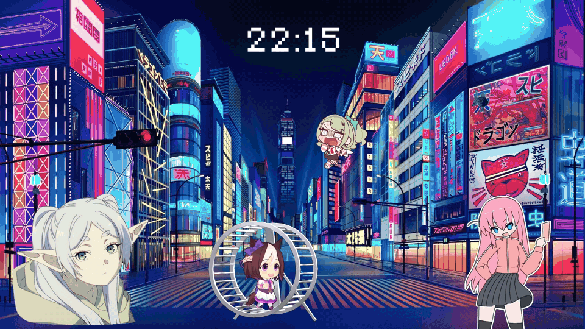
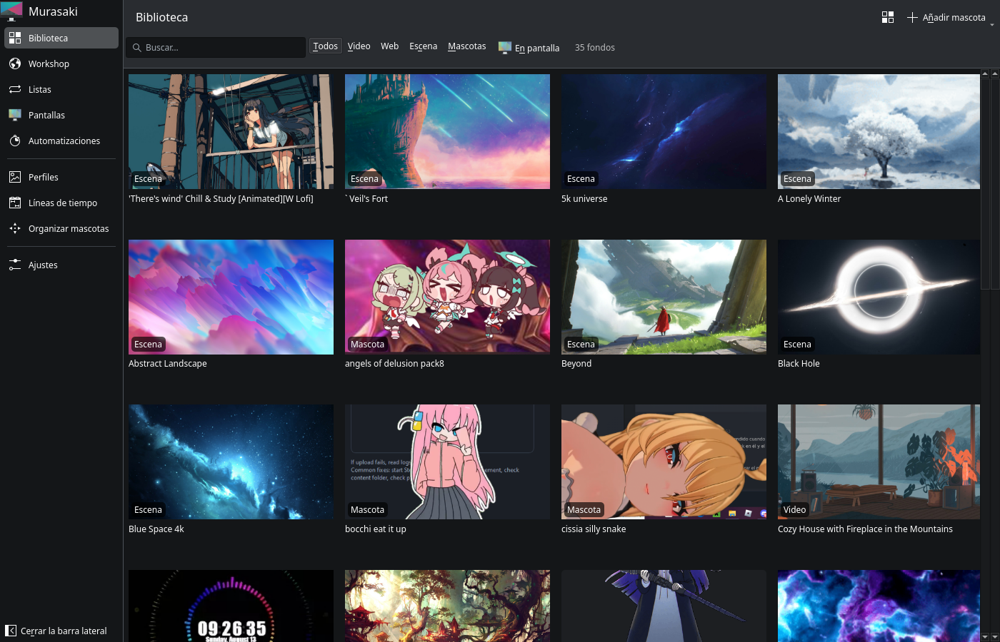
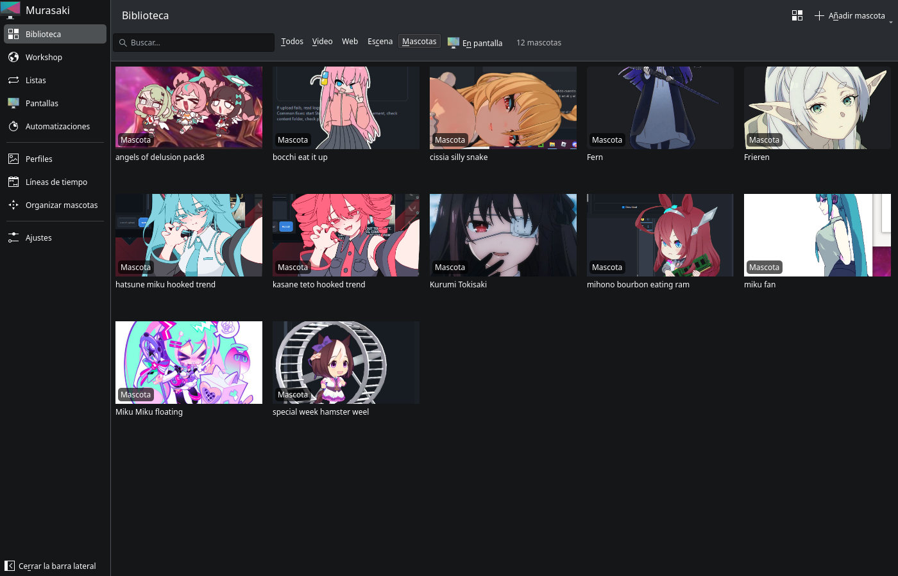
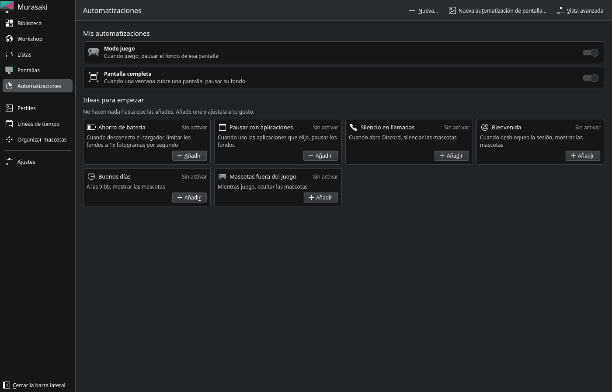

# Murasaki

[Español](README.md) · **English**



Animated wallpapers and desktop overlays for Linux. Murasaki plays the Wallpaper Engine content you already own on Steam: scenes, videos, web wallpapers and Steam Workshop items. Anima Engine desktop pets work too. It reads everything from your own Steam install and never redistributes it.

> [!WARNING]
> **Beta (v0.1).** Murasaki is used every day, but it can still have bugs and some scenes are drawn incomplete. If something does not work, [open an issue](../../issues/new/choose) with your logs ([how to get them](docs/user/logs.md)).

How it is built: `murasakid` indexes your Wallpaper Engine Workshop library and serves it over D-Bus (see `docs/dbus-api.md`). `murasaki-surface` shows video, web and scene wallpapers behind your windows on KDE Plasma (Wayland), Sway, Hyprland and X11 sessions (`docs/user/x11.md`). Scenes need the scene engine (below); without it they show their preview image. On Plasma, desktop icons are hidden while Murasaki runs unless you use the Plasma wallpaper plugin (below).

## Screenshots

| | |
|---|---|
|  |  |
| **Library:** scenes, videos, web wallpapers and pets | Anima Engine **pets** |
|  |  |
| **Each wallpaper** with its properties and the screen it goes on | **Automations:** pause for games, save battery, hide the pets... |

The app follows the system language (Spanish and English).

## User guide

The [user guide](docs/guide/README.md) explains every page of the app, what each setting does and what to do when something goes wrong.

## Requirements

- **Steam with Wallpaper Engine bought and installed.** Murasaki ships no wallpapers: it plays the ones on your account. Install Wallpaper Engine in your Linux Steam (through Proton is enough for it to download; Murasaki does not run it). Scenes need its `assets` folder: without it they stay on their preview image.
- **Anima Engine** on the same account, for the pets.
- **The Steam client does not have to be running:** Murasaki only reads the files Steam already downloaded. Workshop items can also be fetched with [SteamCMD](docs/user/steamcmd.md) and your own account, but Wallpaper Engine itself is installed from Steam.
- **Linux with KDE Plasma 6, GNOME, Sway, Hyprland or X11**, and a Vulkan 1.3 driver (Mesa or NVIDIA) for scenes.

## Install

Download the package of the latest version from [Releases](../../releases):

- **Ubuntu 26.04 and derivatives (.deb):** `sudo apt install ./murasaki_*_amd64.deb`. It needs glibc 2.43 and FFmpeg 8, which only Ubuntu 26.04 has: on Ubuntu 24.04, KDE neon (still based on 24.04) and other distributions use the Flatpak.
- **Any distribution (Flatpak):** `flatpak install --user ./murasaki-*-x86_64.flatpak` (needs the Flathub remote for the KDE runtime).
- **Arch Linux:** build the package with the PKGBUILD in the repo:

  ```sh
  git clone https://github.com/uriel2121ger-art/murasaki
  cd murasaki/packaging/arch && makepkg -si
  ```

The Plasma wallpaper plugin and the GNOME extension are in the `.deb` and the Arch package, not in the Flatpak.

## Build

Requirements: CMake ≥ 3.25, Ninja, a C++20 compiler and Qt ≥ 6.8 (Core, DBus, Test). On Debian/Ubuntu: `qt6-base-dev`.

```bash
cmake --preset dev
cmake --build --preset dev
ctest --preset dev   # the D-Bus test runs under dbus-run-session automatically when it is installed
./build/dev/src/daemon/murasakid --list
```

Everything needs Qt ≥ 6.8 (Ubuntu 26.04 LTS, Fedora 41+, Arch, KDE neon; on Ubuntu 24.04 use the Flatpak). For the wallpaper surface also install `qt6-declarative-dev qt6-webengine-dev libmpv-dev libavformat-dev libavcodec-dev libswscale-dev libavutil-dev pkg-config` and, for the desktop layer, `liblayershellqtinterface-dev`.

The GUI (`murasaki`) needs Qt ≥ 6.8 with Qt Quick Controls 2, Widgets and WebEngine to build, plus Kirigami (KF6, `kirigami` / `qml6-module-org-kde-kirigami`) and QtWebEngine at run time. With `MURASAKI_BUILD_APP=AUTO` (the default) it is built only when Qt ≥ 6.8 and these modules are found; `ON` fails the configure step otherwise and `OFF` skips it.

## Usage

```bash
cmake --install build/dev                 # installs into ~/.local
murasakictl list                          # find an item id
murasakictl set we:1081733658             # all outputs, all desktops
murasakictl set we:123 --output DP-1 --desktop 2 --fill fit
murasakictl mute on                       # mute the default assignment
murasakictl autostart on                  # start the surface with your session (systemd user unit)
murasakictl status
```

Wallpapers pause and go silent while a fullscreen or maximized window covers their output (and, if you ask, while a game runs, on battery, or for chosen applications).

Workshop items can also be downloaded without the Steam client, with your own account, through SteamCMD (`murasakictl steamcmd ...`, the Workshop page): see `docs/user/steamcmd.md`.

Playlists rotate wallpapers on a timer (`murasakictl playlist ...`, the Playlists page) and a wallpaper can be spanned across all screens (`--span`): see `docs/user/playlists-spanning-pause.md`.

## Desktop pets

Anima Engine Workshop items show up in the library as pets. The daemon keeps where each one is shown (`pets.json`), fetches their titles and previews from Steam's public Workshop endpoint (no key, cached) and converts heavy animations once to a light VP9 copy with `ffmpeg`:

```bash
murasakictl pets add anima:3123456789 --output DP-1 --x 200 --y 300 --width 300 --fps 24
murasakictl pets list
murasakictl pets arrange toggle           # move and resize pets with the mouse
murasakictl pets check <item>            # can the overlay play it? one JSON line (see docs/pets/check.md)
murasakictl pets remove <pet id>
```

Anima Engine ignores the frame delays stored in a pet's APNG or GIF and steps every pet at one fixed rate of its own (15 fps). Murasaki uses a fixed rate too, 24 fps by default: `murasakictl pets timing <pet id> fixed 15` gives Anima's, and `murasakictl pets timing <pet id> file` ("Original timing" in the GUI) plays the file with its own delays.

`murasaki-overlay` draws them: one transparent layer-shell window per pet on the overlay layer, above every window (fullscreen ones too) and click-through, playing the original file or the converted copy through libmpv, always muted. The daemon starts the `murasaki-overlay.service` user unit when the first pet is added and stops it when the last one is removed; D-Bus activation of `io.github.uriel2121ger_art.Murasaki.Overlay` starts it too. Pets pause while the session is locked and are never paused for fullscreen windows.

Arrange mode makes pets take the pointer: drag to move, wheel to scale (0.1 to 2 times the native size), drag the corner to resize, the cross removes the pet. Toggle it with `murasakictl pets arrange toggle`, from the GUI, or with the global shortcut Meta+Shift+P (the XDG GlobalShortcuts portal, or KDE's kglobalaccel; rebind it in System Settings). `murasakictl pets set <id> --click-through off --lock on --keep-above off --hover-hide on --smart-dodge on --rotation 90 --flip-h on` changes what a pet does (stored with it; the pets page of the GUI has the same controls, and the overlay acts on all of them: a pet that is not click-through takes the pointer on its opaque pixels and can be dragged, hide under the cursor (`--hover-hide`) and focus fade (`--focus-fade`) follow the cursor and exclude each other, smart dodge steps away from it, rotation and flips are drawn without decoding again, keep above off lets windows cover the pet). Where a compositor can not do one of them exactly the pet says so by name in the overlay's `Windows()` (`degraded`); see `docs/pets/behaviours.md` for what each desktop does, the settings (`MURASAKI_MASK_CACHE_MIB`, `MURASAKI_POINTER`) and the checklist for a first run on a new desktop. Pets that keep the defaults cost what they always did. Meta+Shift+H hides or shows every pet (`murasakictl pets hide|show|toggle`) and Meta+Shift+R is the rescue (`murasakictl pets rescue`): it makes every pet visible, solid and grabbable again after a forgotten flag. See `docs/dbus-api.md` for the API.

## Plasma wallpaper plugin

On KDE Plasma 6 Murasaki can be the desktop's own wallpaper plugin instead of a layer-shell window, so icons, widgets and panels keep working. `cmake --install` ships the plugin; switch to it with:

```bash
murasakictl plasma enable    # make Murasaki the wallpaper of every desktop (containment)
murasakictl plasma status    # which desktops use it, whether the package is installed
murasakictl plasma disable   # give every desktop its previous wallpaper back
murasakictl plasma enable --dry-run   # print what would change and change nothing
```

`enable` sets the daemon's `presenter` setting to `plasma`: `murasaki-surface` then opens no windows of its own and renders for the plugin instead (`auto`, the default, uses a window only for outputs without a plugin host; `layer-shell` never uses the plugin). `disable` restores the recorded presenter.

What gets installed (under the install prefix, `~/.local` by default): the package `share/plasma/wallpapers/io.github.uriel2121ger_art.Murasaki/` with `metadata.json`, the QML, and the `Murasaki.Bridge` module inside it, so plasmashell needs no extra environment. The package calls `murasaki-surface --host <output>` once per screen. What `enable` changes outside it: the wallpaper plugin of your Plasma containments (through plasmashell's scripting interface), a backup of `plasma-org.kde.plasma.desktop-appletsrc` and a record of the previous plugins in `~/.local/state/murasaki/`, and the daemon setting.

To undo: `murasakictl plasma disable`. If plasmashell is unusable, pick another wallpaper type in the desktop settings, or restore the backed-up `plasma-org.kde.plasma.desktop-appletsrc` from `~/.local/state/murasaki/` and restart plasmashell; removing the installed package directory removes the plugin itself. The plugin needs `murasakid` of this version or newer (API revision 4); an older running daemon is reported and the wallpaper shows a note until it is restarted.

After an upgrade (`cmake --install`, a package update) you do not restart plasmashell for the hosts: the plugin watches the installed `murasaki-surface` (and the scene engine) and, once the new file is in place, executable and unchanged for a couple of seconds, starts its host processes again from it, keeping the last picture on screen until the new one draws. A new binary that crashes goes through the usual restart backoff and is named in plasmashell's log (`BridgeItem: ... was replaced on disk`). Only the plugin's own library, which plasmashell has loaded, needs `systemctl --user restart plasma-plasmashell` to be replaced (it changes rarely; the release notes say when). Restart `murasakid` as usual after an install.

## Scene engine

Scene wallpapers are drawn by Murasaki's own Vulkan engine, `murasaki-scene-vk`, which sends its frames to `murasaki-surface` over a bridge. `cmake --install` installs it together with its video plugin and the `murasaki-sandbox` helper that confines it; it needs a Vulkan 1.3 driver (Mesa RADV/ANV or the NVIDIA driver). Scenes also need Wallpaper Engine's `assets` directory, which `murasakid` finds in your Steam install. Compiled shaders are cached in `~/.cache/murasaki/shader-cache`.

Before a scene is shown the engine checks it (`murasaki-scene-vk --check`); a scene that uses something the engine cannot draw yet still plays, and its page in the app names it as incomplete with the reason. Set `MURASAKI_SCENE_VK` to the path of an engine executable to use another build.

## Packages

`cmake -B build/pkg -G Ninja -DCMAKE_BUILD_TYPE=Release -DCMAKE_INSTALL_PREFIX=/usr -DMURASAKI_SYSTEMD_USER_UNIT_DIR=lib/systemd/user && cmake --build build/pkg && (cd build/pkg && cpack -G DEB)` builds a `.deb` (user services only, nothing is enabled: the post-install message says how). `packaging/flatpak/` has the Flatpak manifest and its notes. Details in `docs/design/specs/2026-10-17-murasaki-packaging-design.md`.

## Other compositors

Sway, labwc, Hyprland, river, niri and COSMIC are supported through wlr-layer-shell; `docs/wlroots.md` says what differs from Plasma (layer, how a covering window is detected, pause rules without KWin) and how to test it nested.

## GNOME

GNOME has no layer-shell: Murasaki uses windows and a GNOME Shell extension (`data/gnome-shell/`, GNOME 46 to 50, experimental). See `docs/gnome.md`.

## Security

Workshop content is not reviewed by anyone, so Murasaki never executes anything from an item, flags items that ship programs, gives web wallpapers no network unless you allow it per wallpaper, and runs the scene engines in a Landlock sandbox (`murasaki-sandbox`, installed next to the engines). `docs/security.md` has the threat model, what each layer covers and does not, how to allow the network for one wallpaper, and how to turn the sandbox off for debugging.

## License

Dual-licensed: GPL-3.0-or-later, or a commercial license from the copyright holder. See `LICENSING.en.md`.
