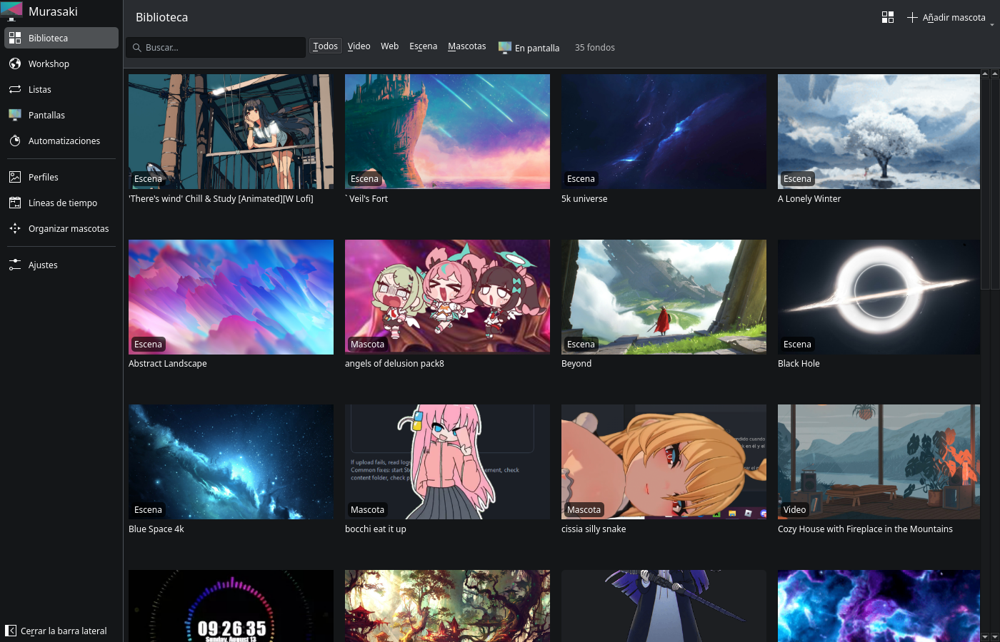
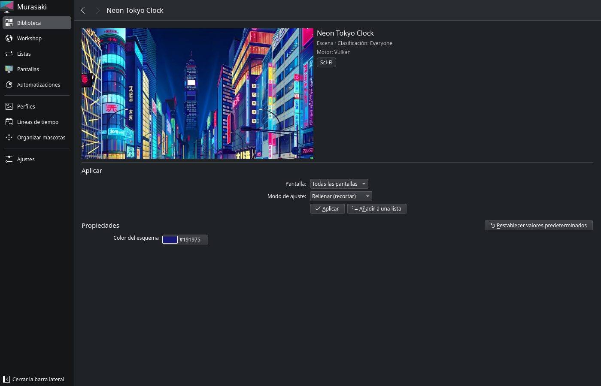
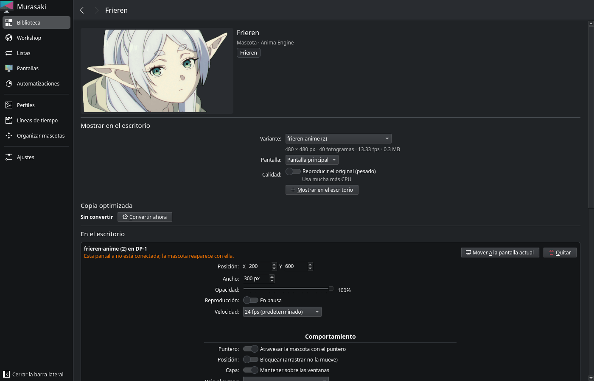
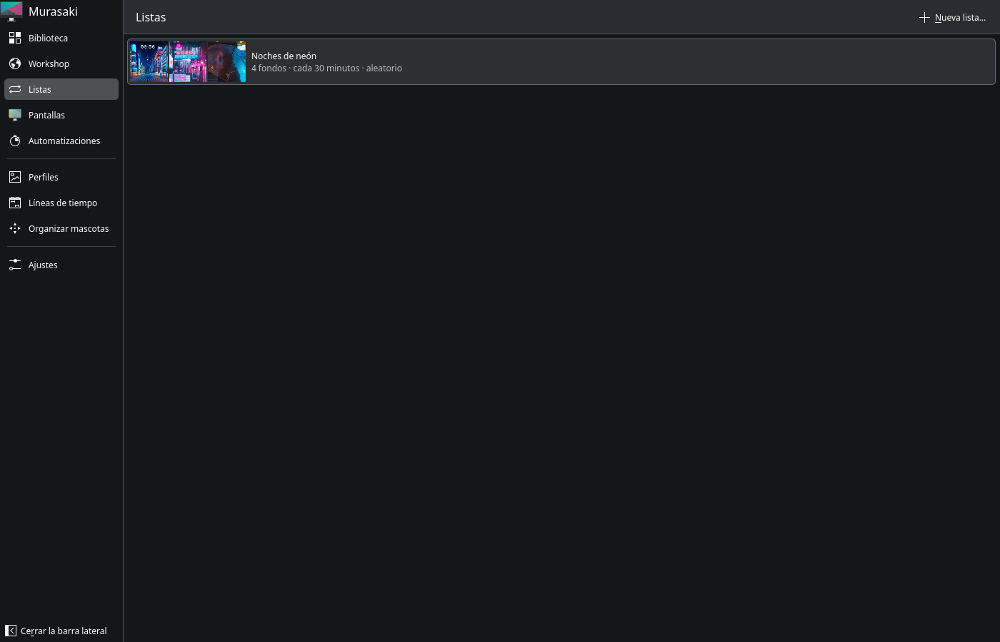
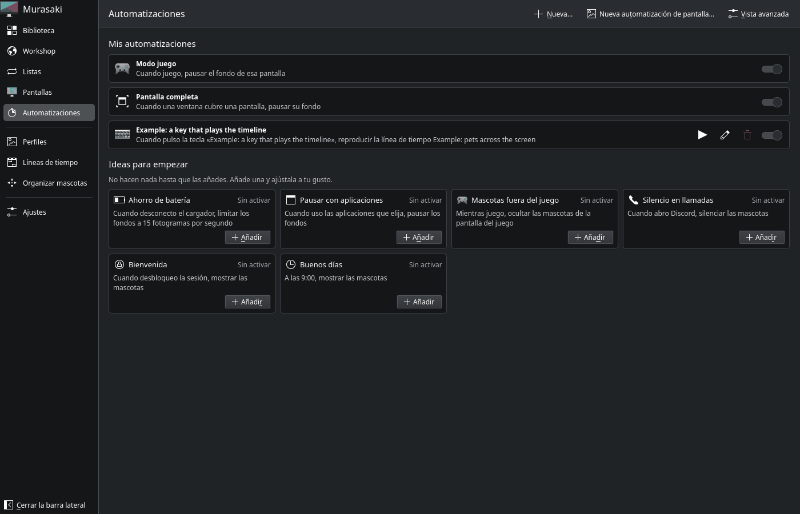
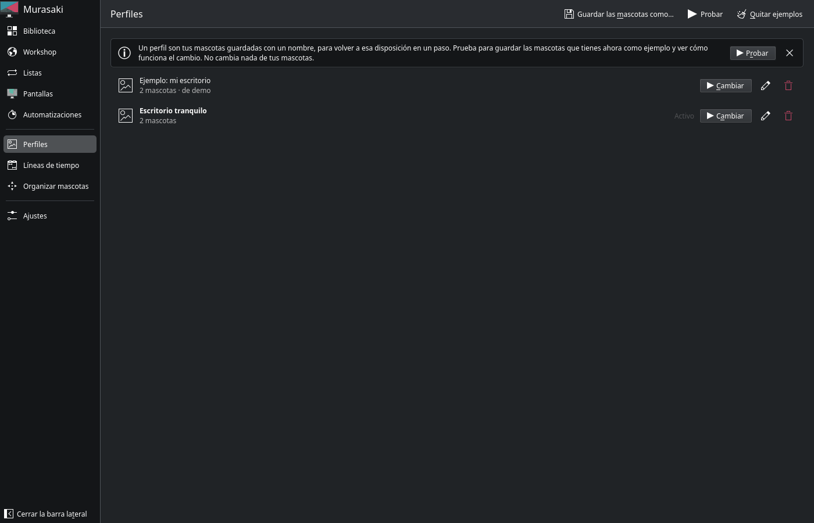
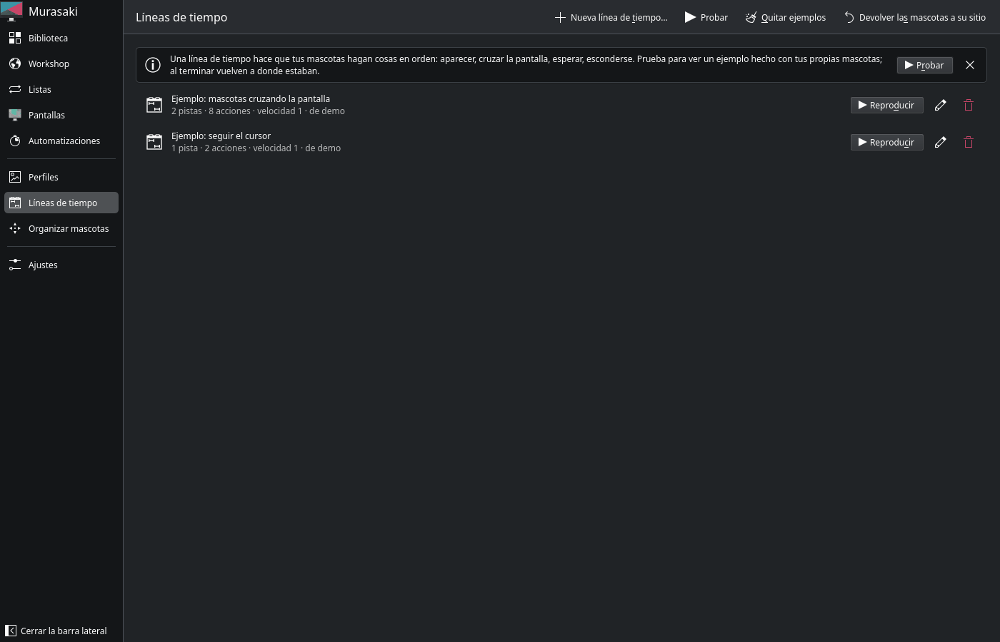
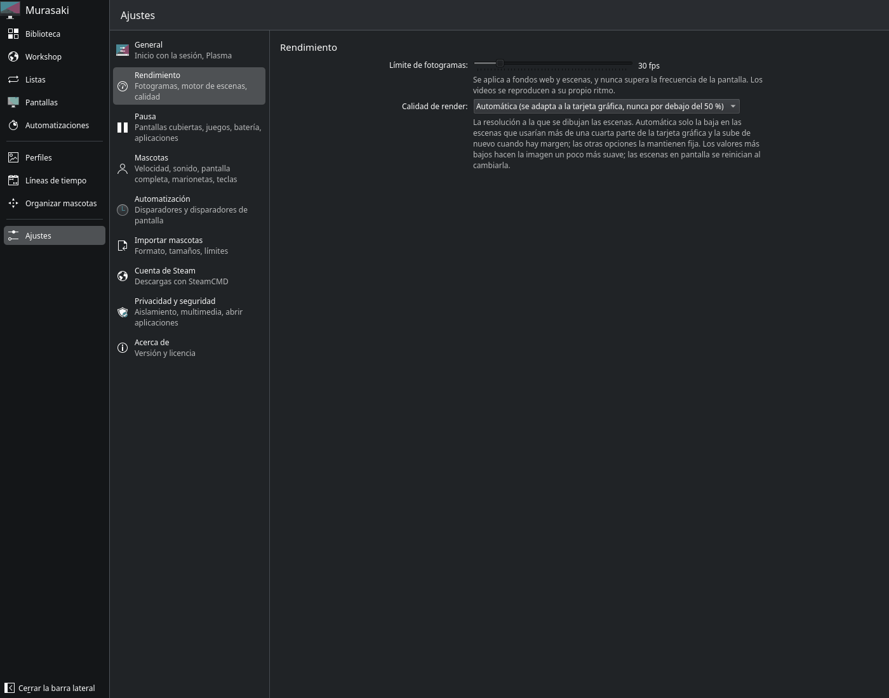
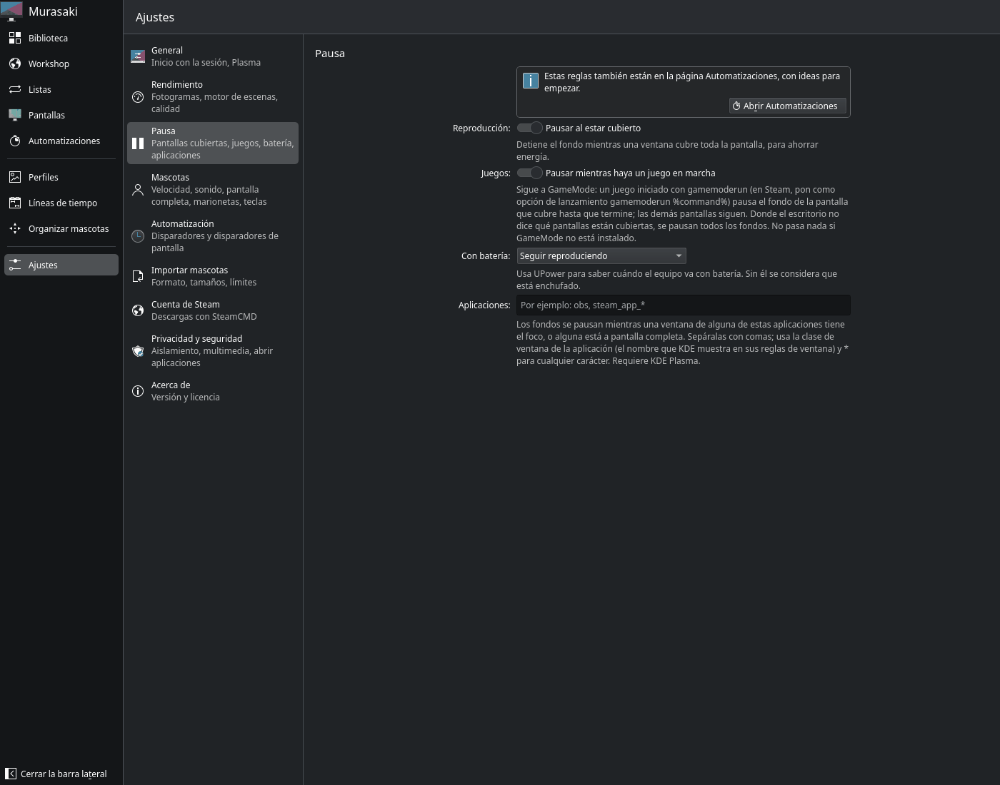
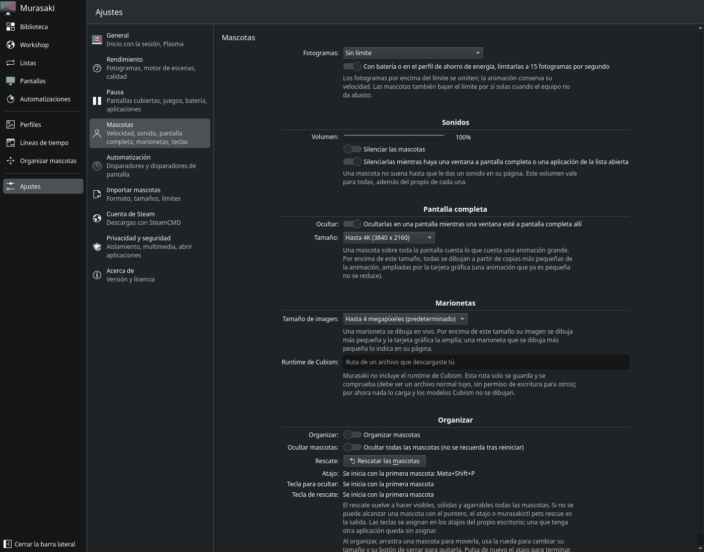

# Guía de uso de Murasaki

**Español** · [English](../guide/README.md)

Esta guía explica qué hay en cada página de la app y qué hace cada ajuste. Si buscas los comandos de terminal (`murasakictl`), están en el [README](../../README.md#uso).

- [Primeros pasos](#primeros-pasos)
- [Biblioteca](#biblioteca)
- [La página de un fondo](#la-página-de-un-fondo)
- [Mascotas](#mascotas)
- [Workshop](#workshop)
- [Listas](#listas)
- [Pantallas](#pantallas)
- [Automatizaciones](#automatizaciones)
- [Perfiles](#perfiles)
- [Líneas de tiempo](#líneas-de-tiempo)
- [Ajustes](#ajustes)
- [Qué funciona en cada escritorio](#qué-funciona-en-cada-escritorio)
- [Problemas frecuentes](#problemas-frecuentes)
- [Privacidad](#privacidad)

## Primeros pasos

1. **Instala Steam y Wallpaper Engine.** Murasaki no trae fondos: reproduce los que tienes en Steam. Necesitas tener Wallpaper Engine comprado e instalado en tu Steam de Linux (con Proton basta para que descargue el contenido; Murasaki no lo ejecuta). Para las mascotas, Anima Engine.
2. **Suscríbete a fondos** en el Workshop de Steam, desde el navegador, el cliente de Steam o la página [Workshop](#workshop) de Murasaki. Steam los descarga en tu equipo.
3. **Abre Murasaki.** La [Biblioteca](#biblioteca) muestra todo lo que tienes suscrito. Si dice "No se encontró Steam" o "Wallpaper Engine no está instalado", revisa el paso 1 y pulsa **Iniciar servicio**.
4. **Abre un fondo y pulsa Aplicar.** Aparece detrás de tus ventanas.
5. **Que arranque solo:** en [Ajustes > General](#general), activa **Inicio automático**.

En KDE Plasma, mientras Murasaki está activo, los iconos del escritorio se ocultan. Para conservarlos, activa **Integración con el escritorio (Plasma)** en Ajustes > General: Murasaki pasa a ser el fondo del propio escritorio de Plasma.

## Biblioteca



Todo lo que tienes suscrito en el Workshop, más las mascotas que importes.

- **Buscar…** filtra por título.
- **Todos, Video, Web, Escena, Mascotas** filtran por tipo. **En pantalla** muestra solo lo que se ve ahora en alguna pantalla.
- **Vista** (arriba a la derecha) cambia el tamaño de las miniaturas.
- **Añadir mascota** crea una mascota a partir de un archivo propio: una animación (GIF, WebP, APNG), una hoja de sprites, una serie de imágenes, un ZIP de fotogramas, un vídeo, un paquete `.mdaa` o una carpeta de marioneta (Inochi2D). Ver [Crear una mascota propia](#crear-una-mascota-propia).
- Clic derecho en un fondo: **Abrir**, **Añadir a una lista…** y **Abrir el Workshop**.

Cada tarjeta lleva una etiqueta con su tipo y, si hace falta, un aviso: **En pantalla**, **Internet** (es un fondo web que pide conexión), **Contiene programas** (el elemento trae ejecutables; Murasaki nunca los ejecuta), **Falta una dependencia** (necesita otro elemento del Workshop) o **No válido**.

## La página de un fondo



- Arriba: la vista previa, el tipo, la clasificación de edad y el **motor** que lo dibuja. Una escena que usa algo que el motor aún no sabe dibujar se reproduce igual, y aquí lo indica como incompleta con el motivo.
- **Aplicar:**
  - **Pantalla:** todas, o una en concreto.
  - **Escritorio:** todos los escritorios virtuales, o uno. Así cada escritorio puede tener su fondo.
  - **Modo de ajuste:** **Rellenar (recortar)** llena la pantalla y recorta lo que sobra; **Ajustar (con bandas)** muestra la imagen entera con bandas; **Estirar** la deforma para llenar.
  - **Silenciar:** quita el sonido de este fondo.
  - **Extender por todas las pantallas:** un solo fondo repartido por todas las pantallas como una única imagen.
  - **Aplicar** lo muestra; **Añadir a una lista** lo mete en una [lista](#listas).
- **Propiedades:** los ajustes que el autor del fondo dejó cambiar (colores, velocidad, mostrar u ocultar partes, el reloj…). Si el fondo está en pantalla, los cambios se ven al instante. **Restablecer valores predeterminados** vuelve a los del autor.
- **Este fondo puede usar internet:** solo en fondos web. Está desactivado por defecto; actívalo solo si el fondo lo necesita (clima, noticias) y confías en él.

## Mascotas

Las mascotas son animaciones que viven encima de tus ventanas. Vienen de Anima Engine (Workshop) o de tus propios archivos.



**Mostrar en el escritorio:**
- **Variante:** muchas mascotas traen varias animaciones; elige cuál.
- **Pantalla:** dónde aparece.
- **Calidad:** **Reproducir el original (pesado)** usa el archivo tal cual. Por defecto se usa una **copia optimizada** que gasta mucha menos CPU; se crea una sola vez, en segundo plano.

**En el escritorio** (para cada mascota que ya está puesta):
- **Posición** y **Ancho** en píxeles, **Opacidad** y **Reproducción** (pausarla).
- **Velocidad:** 24 fps por defecto; 15 fps es el ritmo de Anima Engine; **Tiempo original** usa los tiempos del propio archivo.
- **Mover a la pantalla actual** la trae a la vista si se perdió; **Quitar** la retira del escritorio.

**Comportamiento:**
- **Atravesar la mascota con el puntero:** encendido, los clics pasan a la ventana de debajo. Apagado, puedes agarrar y arrastrar la mascota.
- **Bloquear:** arrastrarla no la mueve.
- **Mantener sobre las ventanas.**
- **Bajo el cursor:** nada, ocultarla, o atenuarla y dejar pasar el cursor.
- **Esquivar:** se aparta del cursor.
- **Rotación** y **Voltear**.

**Sonido:** una mascota puede tener un sonido (de un archivo de audio o del sonido de un vídeo importado). **Suena:** nunca, una vez al aparecer, cada vez que la animación se repite, una y otra vez, o al hacer clic en ella. Necesita PipeWire.

**Estados y ratón:** qué animación muestra la mascota en reposo, agarrada, llevada y recién soltada. **Seguimiento del ratón** hace que se gire hacia el cursor o lo siga a una distancia.

**Pantalla completa:** **Mostrar como** una mascota, sobre esta pantalla o sobre todas: la animación cubre la pantalla entera como un fondo transparente, sin tocar el ratón ni el teclado.

### Organizar mascotas

**Organizar mascotas**, en el menú lateral, entra en el modo de colocar: arrastra una mascota para moverla, usa la rueda del ratón para cambiar su tamaño y pulsa su cruz para quitarla. Pulsa otra vez para terminar. También con **Meta+Shift+P**.

- **Meta+Shift+H** oculta o muestra todas las mascotas.
- **Meta+Shift+R** es el **rescate**: si una mascota quedó invisible, transparente o imposible de agarrar por una opción olvidada, la vuelve a dejar visible, sólida y agarrable.

Los atajos se cambian en la configuración de atajos de tu escritorio.

### Crear una mascota propia

**Biblioteca > Añadir mascota** abre el importador. Elige el origen (archivo de animación, hoja de sprites, imágenes, ZIP, vídeo o paquete), ajusta el tamaño de los fotogramas o el recorte si hace falta y guarda. La mascota aparece en la Biblioteca como cualquier otra. Por seguridad, las importaciones se hacen dentro del sandbox (ver [Privacidad y seguridad](#privacidad-y-seguridad)).

## Workshop

El Workshop de Steam dentro de la app. Busca un fondo y:
- **Suscribirse** (con tu sesión de Steam en la página) hace que Steam lo descargue, y aparece en la Biblioteca.
- **Abrir en Steam** lo abre en el cliente de Steam.
- **Descargar con SteamCMD** lo baja sin el cliente de Steam, con tu propia cuenta (ver [Cuenta de Steam](#cuenta-de-steam)).
- Una vez instalado, **Usar ahora** lo aplica a todas las pantallas. Si alguna pantalla tiene su propio fondo, Murasaki pregunta si reemplazarlo.

## Listas



Una lista cambia el fondo de una pantalla cada pocos minutos.

- **Nueva lista…** y luego **Añadir fondos…** (o **Añadir a una lista** desde la página de un fondo).
- **Orden:** en orden o aleatorio. **Cambiar cada:** cada cuántos minutos. **Al iniciar sesión:** empezar con el siguiente fondo.
- **Subir**, **Bajar** y **Quitar de la lista** en cada fondo.
- **Aplicar** la pone en una pantalla, con las mismas opciones que un fondo (pantalla, escritorio, modo de ajuste, silenciar, extender). Mientras suena: **Anterior**, **Siguiente** y **Detener**.

## Pantallas

Cada pantalla conectada, qué muestra, si está reproduciendo o en pausa y por qué ("hay un juego en marcha", "con batería", "cubierta"…). En **Asignaciones** ves qué fondo va en cada pantalla y escritorio, y puedes **Silenciar** o **Quitar** cada uno.

Si dice "El fondo de pantalla no está en ejecución", pulsa **Iniciar**.

## Automatizaciones



Lo que pasa solo. Arriba, **Mis automatizaciones**, cada una con su interruptor. Abajo, **Ideas para empezar**, que se añaden con un clic.

Para los fondos:
- **Modo juego:** mientras juegas, pausa el fondo de la pantalla del juego. Funciona con GameMode: lanza el juego con `gamemoderun` (en Steam, en las opciones de lanzamiento: `gamemoderun %command%`).
- **Pantalla completa:** cuando una ventana cubre una pantalla, pausa su fondo.
- **Ahorro de batería:** al desconectar el cargador, limita los fondos a 15 fps o los pausa.
- **Pausar con aplicaciones:** pausa los fondos mientras usas las aplicaciones que elijas (por ejemplo OBS).

Para las mascotas:
- **Mascotas fuera del juego:** mientras juegas, oculta las mascotas de la pantalla del juego; las de las otras pantallas siguen.
- **Silencio en llamadas**, **Bienvenida** (mostrar las mascotas al desbloquear la sesión), **Buenos días** (mostrarlas a una hora)…

**Nueva…** crea una automatización propia: elige **cuándo** (una aplicación se abre, se cierra o recibe el foco; una hora; batería o corriente; bloquear o desbloquear; empieza o termina un juego; se conecta una pantalla; una tecla…) y **qué** hacer con las mascotas (ocultarlas, mostrarlas, silenciarlas, reproducir una línea de tiempo, cambiar a un perfil, reproducir un sonido).

**Vista avanzada** muestra todos los disparadores con su último resultado, y los **disparadores de pantalla**: las mascotas reaccionan a lo que se ve en una región de tu pantalla (por ejemplo, esconderse mientras se ve un juego). Están apagados hasta que los activas en [Ajustes > Automatización](#automatización), y el escritorio te pide permiso antes de mirar la pantalla.

Las automatizaciones solo actúan sobre las mascotas y los fondos: nunca ejecutan un programa ni abren un archivo o una dirección web.

## Perfiles



Un perfil guarda tus mascotas (cuáles, dónde y cómo) con un nombre, para volver a esa disposición en un paso. No guarda fondos ni ajustes.

- **Guardar las mascotas como…** crea un perfil con lo que hay ahora en el escritorio.
- **Cambiar** pone las mascotas de ese perfil. Si mueves mascotas después, el perfil se marca como **modificado** hasta que lo guardes otra vez.
- **Probar** guarda tus mascotas como perfil de ejemplo para ver cómo funciona; **Quitar ejemplos** lo borra.

## Líneas de tiempo



Una línea de tiempo hace que tus mascotas hagan cosas en orden: aparecer, cruzar la pantalla, esperar, esconderse, sonar. Se reproduce con **Reproducir**, desde una automatización o con una tecla.

- **Nueva línea de tiempo…** abre el editor, con pistas de acciones para cada mascota.
- **Probar** hace un ejemplo con tus propias mascotas y lo reproduce. Al terminar vuelven a donde estaban; **Devolver las mascotas a su sitio** lo fuerza.
- Los paquetes importados (`.mdaa`) pueden traer escenas que se convierten en líneas de tiempo desde la página de la mascota.

## Ajustes

### General

- **Inicio automático:** mostrar el fondo al iniciar sesión.
- **Integración con el escritorio (Plasma):** el fondo va detrás de los iconos del escritorio de Plasma, que siguen funcionando.

### Rendimiento



- **Límite de fotogramas:** para fondos web y escenas (los vídeos van a su ritmo). Nunca supera la frecuencia de tu pantalla. Menos fps, menos consumo.
- **Calidad de render:** la resolución a la que se dibujan las escenas. **Automática** solo la baja en las escenas que usarían más de una cuarta parte de la tarjeta gráfica.

### Pausa



Las mismas reglas que en Automatizaciones, con su explicación:
- **Pausar al estar cubierto:** detiene el fondo mientras una ventana cubre toda la pantalla.
- **Pausar mientras haya un juego en marcha:** solo la pantalla que cubre el juego; las demás siguen. Necesita GameMode.
- **Con batería:** seguir reproduciendo, limitar o pausar. Necesita UPower.
- **Aplicaciones:** nombres de clase de ventana separados por comas (`obs, steam_app_*`); `*` vale por cualquier texto. Solo en KDE Plasma.

### Mascotas



- **Fotogramas:** un límite para todas las mascotas, y limitarlas a 15 fps con batería o en el perfil de ahorro de energía.
- **Sonidos:** volumen general, silenciar todas, y silenciarlas mientras haya una ventana a pantalla completa.
- **Pantalla completa:** ocultar las mascotas a pantalla completa cuando hay una ventana a pantalla completa en esa pantalla, y el tamaño máximo que dibujan.
- **Marionetas:** el tamaño de imagen de las marionetas (Inochi2D).
- **Organizar:** el modo de colocar, ocultar todas, el **rescate** y los atajos.

### Automatización

- **Los disparadores están activados:** el interruptor general. Apagado, nada se dispara.
- **Disparadores de pantalla:** permitirlos, cuántas veces por segundo miran (más, más rápido y más CPU), y si ignorar regiones que tapan tus propias mascotas.

### Importar mascotas

El formato en que se guardan las importaciones (APNG sin pérdida o WebP más pequeño), qué hacer con imágenes de distinto tamaño, la velocidad por defecto, el tamaño máximo, y si importar automáticamente los ZIP, vídeos o paquetes que traen algunos elementos del Workshop. **Importar solo dentro del sandbox** viene activado.

### Cuenta de Steam

Inicia sesión con tu cuenta de Steam para descargar elementos del Workshop con **SteamCMD**, la herramienta oficial de Valve, sin el cliente de Steam. La contraseña y el código de Steam Guard se los pide SteamCMD; Murasaki no los guarda. Tu cuenta debe tener Wallpaper Engine.

### Privacidad y seguridad

- **Ejecutar los motores de escenas en un entorno aislado:** nadie revisa las escenas del Workshop, así que el motor se ejecuta en un sandbox (Landlock) donde solo puede leer el fondo y lo mínimo del sistema. Déjalo activado. **Estricto** no inicia una escena si el sandbox no está disponible.
- **Medios:** decir a los fondos que lo muestran qué música suena (título, artista y carátula). **Carátula** permite descargar la carátula.
- **Accesos directos:** algunos fondos traen botones para abrir aplicaciones; solo abren las que tú elegiste.

### Acerca de

La versión de Murasaki y del servicio, y la licencia.

## Qué funciona en cada escritorio

| Escritorio | Fondos | Mascotas | Notas |
|---|---|---|---|
| **KDE Plasma 6 (Wayland)** | Sí | Sí | El más completo: integración con el escritorio de Plasma, pausa por aplicaciones |
| **GNOME 46–50** | Sí | Sí | Necesita la extensión de GNOME Shell (incluida en el `.deb`). Experimental |
| **Hyprland, Sway, labwc, river, niri, COSMIC** | Sí | Sí | Mediante wlr-layer-shell; algunas reglas de pausa dependen del compositor |
| **X11** | Sí | Sí | Las mascotas a pantalla completa necesitan un compositor |

Cuando algo no se puede hacer exactamente en un escritorio, la página de la mascota o del fondo lo dice.

## Problemas frecuentes

**La biblioteca está vacía o dice "No se encontró Steam".** Comprueba que Steam está instalado y has iniciado sesión al menos una vez, y que tienes Wallpaper Engine. Si usas Steam de Flatpak o Snap también se encuentra. Después pulsa **Iniciar servicio**.

**Una escena sale "incompleta".** El motor de escenas de Murasaki todavía no dibuja todos los efectos de Wallpaper Engine. La escena se reproduce igual y su página dice qué falta. Si se ve muy distinta del original, [abre un issue](https://github.com/uriel2121ger-art/murasaki/issues/new/choose) con el enlace del fondo.

**En Plasma desaparecieron los iconos del escritorio.** Activa **Integración con el escritorio (Plasma)** en Ajustes > General.

**Una mascota no se ve o no se puede agarrar.** Pulsa **Meta+Shift+R** (rescate). Si estaba en otra pantalla, **Mover a la pantalla actual** en su página.

**Las mascotas se ocultan con un juego.** Es la automatización **Mascotas fuera del juego**; apágala en Automatizaciones si no la quieres.

**El fondo no se pausa con los juegos.** El juego tiene que ir con GameMode (`gamemoderun %command%` en Steam).

**Consume mucho.** Baja el **Límite de fotogramas** y deja la **Calidad de render** en Automática. Para las mascotas, usa la copia optimizada en vez del original.

### Cómo sacar los logs

Murasaki guarda lo que hace en `~/.local/state/murasaki/logs/`: `murasakid.log` (el servicio), `surface.log` (los fondos), `overlay.log` (las mascotas) y `scene-<pantalla>.log` (cada escena). Para reportar un fallo:

```bash
tar czf murasaki-logs.tar.gz -C ~/.local/state/murasaki logs
```

y adjunta `murasaki-logs.tar.gz` al issue. Los logs nombran fondos y rutas de tu equipo; échales un vistazo antes de subirlos. Más detalles en [logs.md](../user/logs.md).

## Privacidad

Murasaki **no envía nada**: no hay telemetría ni reportes automáticos, y los logs se quedan en tu equipo. Solo se conecta a internet para:
- pedir a Steam los títulos y vistas previas de los elementos del Workshop (API pública, sin tu cuenta);
- descargar la carátula de la música que suena, si lo permites en Privacidad y seguridad;
- lo que abras tú: la página del Workshop, SteamCMD o un fondo web al que des permiso.
