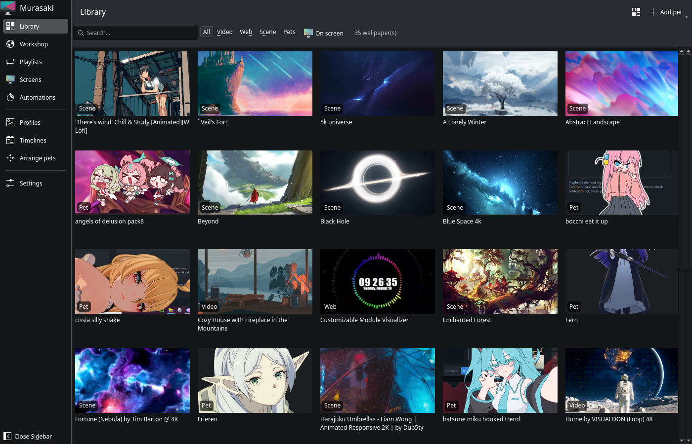
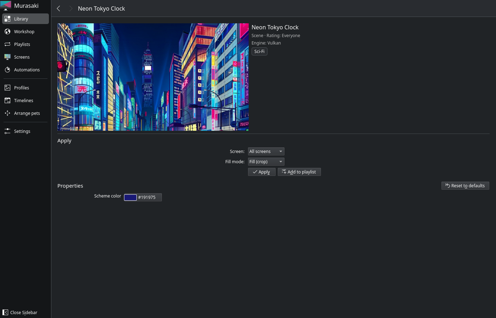
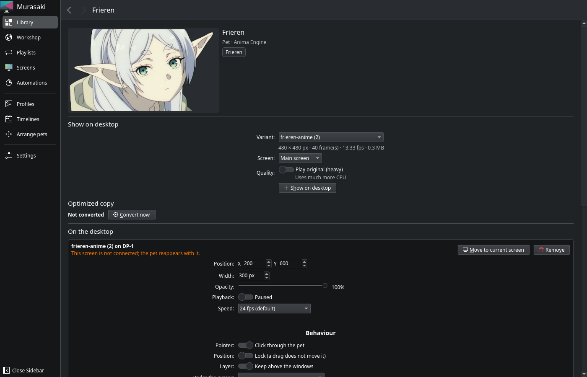
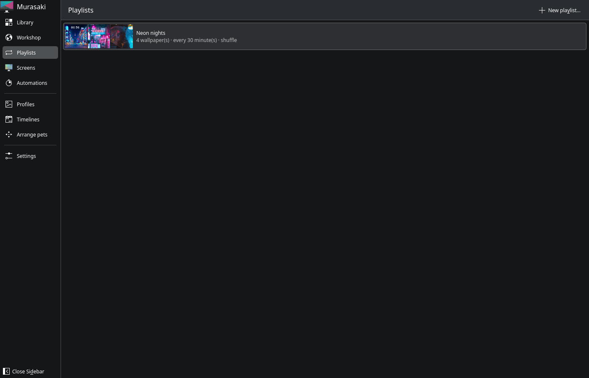
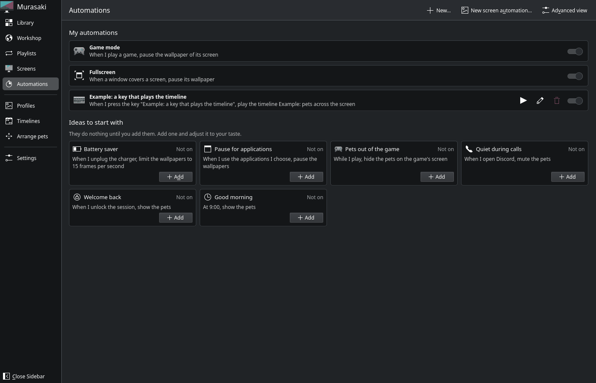
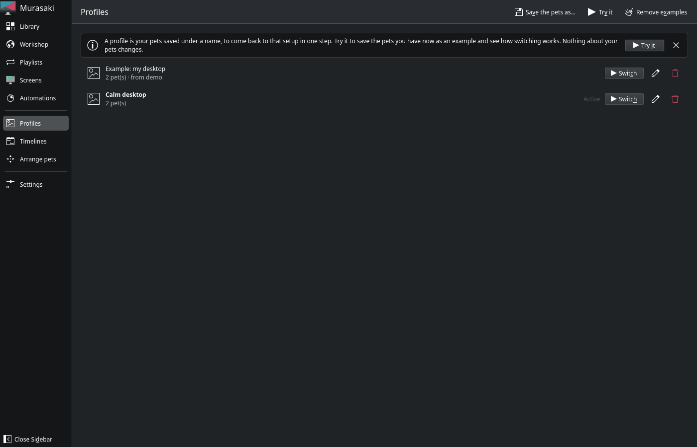
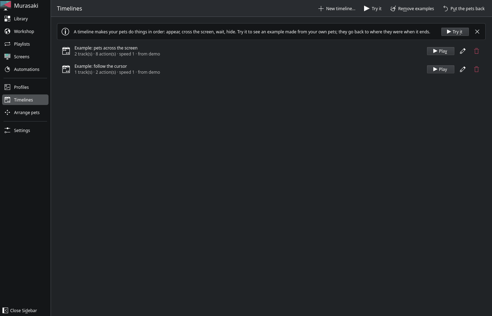
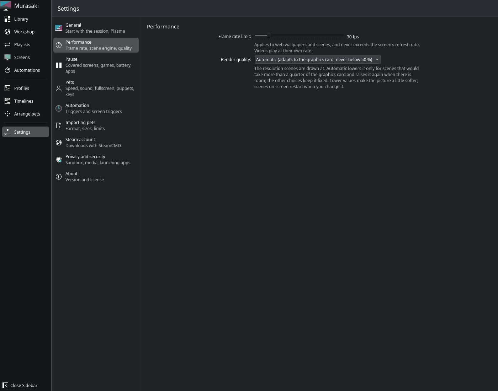
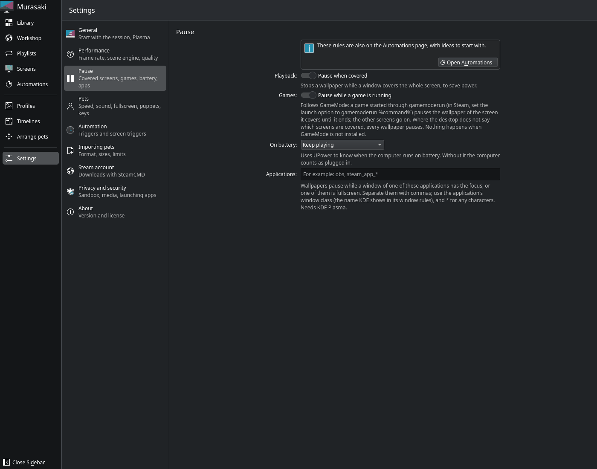
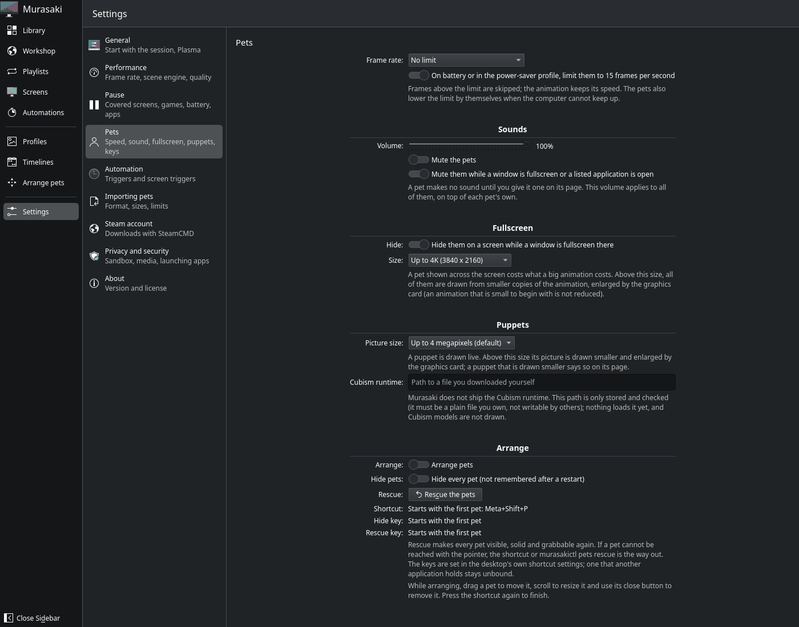

# Murasaki user guide

[Español](../guia/README.md) · **English**

This guide explains what is on each page of the app and what each setting does. The terminal commands (`murasakictl`) are in the [README](../../README.en.md#usage).

- [Getting started](#getting-started)
- [Library](#library)
- [A wallpaper's page](#a-wallpapers-page)
- [Pets](#pets)
- [Workshop](#workshop)
- [Playlists](#playlists)
- [Screens](#screens)
- [Automations](#automations)
- [Profiles](#profiles)
- [Timelines](#timelines)
- [Settings](#settings)
- [What works on each desktop](#what-works-on-each-desktop)
- [Common problems](#common-problems)
- [Privacy](#privacy)

## Getting started

1. **Install Steam and Wallpaper Engine.** Murasaki ships no wallpapers: it plays the ones you have on Steam. You need Wallpaper Engine bought and installed in your Linux Steam (through Proton is enough for it to download the content; Murasaki does not run it). For pets, Anima Engine.
2. **Subscribe to wallpapers** on the Steam Workshop, from a browser, the Steam client or Murasaki's [Workshop](#workshop) page. Steam downloads them to your computer.
3. **Open Murasaki.** The [Library](#library) shows everything you are subscribed to. If it says "Steam was not found" or "Wallpaper Engine is not installed", check step 1 and press **Start service**.
4. **Open a wallpaper and press Apply.** It shows behind your windows.
5. **To start it with your session:** turn on **Autostart** in [Settings > General](#general).

On KDE Plasma the desktop icons are hidden while Murasaki runs. To keep them, turn on **Desktop integration (Plasma)** in Settings > General: Murasaki then becomes the Plasma desktop's own wallpaper.

## Library



Everything you are subscribed to on the Workshop, plus the pets you import.

- **Search…** filters by title.
- **All, Video, Web, Scene, Pets** filter by kind. **On screen** shows only what is on a screen now.
- **View** (top right) changes the thumbnail size.
- **Add pet** makes a pet from a file of your own: an animation (GIF, WebP, APNG), a sprite sheet, a series of images, a ZIP of frames, a video, an `.mdaa` package or a puppet folder (Inochi2D). See [Making your own pet](#making-your-own-pet).
- Right-click a wallpaper: **Open**, **Add to playlist** and **Open the Workshop**.

Each card shows its kind and, when needed, a badge: **On screen**, **Internet** (a web wallpaper that asks for the network), **Contains programs** (the item ships executables; Murasaki never runs them), **Missing dependency** (it needs another Workshop item) or **Invalid**.

## A wallpaper's page



- At the top: the preview, the kind, the age rating and the **engine** that draws it. A scene that uses something the engine cannot draw yet still plays, and its page says it is incomplete and why.
- **Apply:**
  - **Screen:** all of them, or one.
  - **Desktop:** all virtual desktops, or one, so each desktop can have its own wallpaper.
  - **Fill mode:** **Fill (crop)** fills the screen and crops the rest; **Fit (letterbox)** shows the whole picture with bars; **Stretch** distorts it to fill.
  - **Mute:** silences this wallpaper.
  - **Span across all screens:** one wallpaper over every screen as a single picture.
  - **Apply** shows it; **Add to playlist** puts it in a [playlist](#playlists).
- **Properties:** the options the wallpaper's author made adjustable (colours, speed, showing or hiding parts, the clock…). If the wallpaper is on screen the changes show at once. **Reset to defaults** goes back to the author's.
- **This wallpaper can use the internet:** web wallpapers only. Off by default; turn it on only when the wallpaper needs it (weather, news) and you trust it.

## Pets

Pets are animations that live above your windows. They come from Anima Engine (Workshop) or from your own files.



**Show on desktop:**
- **Variant:** many pets ship several animations; pick one.
- **Screen:** where it appears.
- **Quality:** **Play original (heavy)** uses the file as it is. By default an **Optimized copy** plays, which uses much less CPU; it is made once, in the background.

**On the desktop** (for each pet already placed):
- **Position** and **Width** in pixels, **Opacity** and **Playback** (pause it).
- **Speed:** 24 fps by default; 15 fps is Anima Engine's rate; **Original timing** uses the file's own timing.
- **Move to current screen** brings it back if it got lost; **Remove** takes it off the desktop.

**Behaviour:**
- **Click through the pet:** on, clicks go to the window below. Off, you can grab and drag the pet.
- **Lock (a drag does not move it):** dragging does not move it.
- **Keep above the windows.**
- **Under the cursor:** nothing, hide it, or fade it and let the cursor through.
- **Dodge:** it steps away from the cursor.
- **Rotation** and **Flip**.

**Sound:** a pet can have a sound (an audio file, or the sound of an imported video). **Plays:** never, once when the pet appears, every time the animation loops, over and over, or when you click the pet. Needs PipeWire.

**States and mouse:** which animation the pet shows when idle, grabbed, carried and just released. **Mouse tracking** makes it turn to the cursor or follow it at a distance.

**Fullscreen:** **Show as** a pet, over this screen or over every screen: the animation covers the whole screen like a transparent wallpaper, and never takes the mouse or keyboard.

### Arrange pets

**Arrange pets**, in the side menu, enters the arrange mode: drag a pet to move it, use the mouse wheel to resize it and press its cross to remove it. Press again to finish. Also with **Meta+Shift+P**.

- **Meta+Shift+H** hides or shows every pet.
- **Meta+Shift+R** is the **rescue**: when a pet became invisible, transparent or impossible to grab through a forgotten option, it makes it visible, solid and grabbable again.

The shortcuts can be changed in your desktop's shortcut settings.

### Making your own pet

**Library > Add pet** opens the importer. Pick the source (animation file, sprite sheet, images, ZIP, video or package), set the frame size or the crop if needed, and save. The pet shows in the Library like any other. For safety, imports run inside the sandbox (see [Privacy and security](#privacy-and-security)).

## Workshop

The Steam Workshop inside the app. Find a wallpaper and:
- **Subscribe** (signed in to Steam on the page) makes Steam download it, and it shows in the Library.
- **Open in Steam** opens it in the Steam client.
- **Download with SteamCMD** downloads it without the Steam client, with your own account (see [Steam account](#steam-account)).
- Once installed, **Use now** applies it to every screen. If a screen has a wallpaper of its own, Murasaki asks whether to replace it.

## Playlists



A playlist changes a screen's wallpaper every few minutes.

- **New playlist…** then **Add wallpapers…** (or **Add to playlist** on a wallpaper's page).
- **Order:** in order or shuffled. **Change every:** how many minutes. **On login:** start with the next wallpaper.
- **Move up**, **Move down** and **Remove from the playlist** on each wallpaper.
- **Apply** puts it on a screen, with the same options as a wallpaper (screen, desktop, fill mode, mute, span). While it plays: **Previous**, **Next** and **Stop**.

## Screens

Each connected screen, what it shows, whether it plays or is paused and why ("a game is running", "on battery", "covered"…). Under **Assignments** you see which wallpaper goes on each screen and desktop, and can **Mute** or **Remove** each one.

If it says "The wallpaper is not running", press **Start**.

## Automations



What happens by itself. On top, **My automations**, each with its switch. Below, **Ideas to start with**, added with one click.

For the wallpapers:
- **Game mode:** while you play, pause the wallpaper of the game's screen. It works with GameMode: start the game with `gamemoderun` (on Steam, in the launch options: `gamemoderun %command%`).
- **Fullscreen:** when a window covers a screen, pause its wallpaper.
- **Battery saver:** when the charger is unplugged, limit the wallpapers to 15 fps or pause them.
- **Pause for applications:** pause the wallpapers while you use the applications you choose (OBS, for example).

For the pets:
- **Pets out of the game:** while you play, hide the pets on the game's screen; the pets on the other screens stay.
- **Quiet during calls**, **Welcome back** (show the pets when the session is unlocked), **Good morning** (show them at a time)…

**New…** makes an automation of your own: pick **when** (an application opens, closes or gets the focus; a time of day; battery or mains; lock or unlock; a game starts or ends; a screen is connected; a key…) and **what** to do with the pets (hide them, show them, mute them, play a timeline, switch to a profile, play a sound).

**Advanced view** lists every trigger with its last result, and the **screen triggers**: pets react to what shows in a region of your screen (hiding while a game is visible, for example). They are off until you turn them on in [Settings > Automation](#automation), and the desktop asks you before anything looks at the screen.

Automations act only on the pets and the wallpapers: they never run a program or open a file or a web address.

## Profiles



A profile saves your pets (which ones, where and how) under a name, to go back to that layout in one step. It does not save wallpapers or settings.

- **Save the pets as…** makes a profile of what is on the desktop now.
- **Switch** puts that profile's pets on the desktop. If you move pets afterwards, the profile shows **Active · modified** until you save it again.
- **Try it** saves your pets as an example profile to show how it works; **Remove examples** deletes it.

## Timelines



A timeline makes your pets do things in order: appear, cross the screen, wait, hide, play a sound. It plays with **Play**, from an automation or with a key.

- **New timeline…** opens the editor, with tracks of actions for each pet.
- **Try it** makes an example with your own pets and plays it. When it ends they go back to where they were; **Put the pets back** forces it.
- Imported packages (`.mdaa`) can carry scenes that become timelines from the pet's page.

## Settings

### General

- **Autostart:** show the wallpaper when you log in.
- **Desktop integration (Plasma):** the wallpaper goes behind the Plasma desktop's icons, which keep working.

### Performance



- **Frame rate limit:** for web wallpapers and scenes (videos play at their own rate). It never goes above your screen's refresh rate. Fewer fps, less power.
- **Render quality:** the resolution scenes are drawn at. **Automatic** lowers it only for scenes that would take more than a quarter of the graphics card.

### Pause



The same rules as in Automations, with their explanation:
- **Pause when covered:** stops the wallpaper while a window covers the whole screen.
- **Pause while a game is running:** only the screen the game covers; the others go on. Needs GameMode.
- **On battery:** keep playing, limit or pause. Needs UPower.
- **Applications:** window class names separated by commas (`obs, steam_app_*`); `*` matches any text. KDE Plasma only.

### Pets



- **Frames:** a limit for every pet, and holding them to 15 fps on battery or in the power-saver profile.
- **Sounds:** the overall volume, muting them all, and muting them while a window is fullscreen.
- **Fullscreen:** hiding fullscreen pets while a window is fullscreen on that screen, and the largest size they draw.
- **Puppets:** the image size of puppets (Inochi2D).
- **Arrange:** the arrange mode, hiding all, the **rescue** and the shortcuts.

### Automation

- **Triggers are on:** the main switch. Off, nothing fires.
- **Screen triggers:** allow them, how many looks a second they take (more reacts sooner and uses more CPU), and whether to ignore regions your own pets cover.

### Importing pets

The format imports are saved in (lossless APNG or smaller WebP), what to do with images of other sizes, the default speed, the largest import, and whether to import automatically the ZIPs, videos or packages some Workshop items carry. **Import only inside the sandbox** is on.

### Steam account

Sign in with your Steam account to download Workshop items with **SteamCMD**, Valve's official tool, without the Steam client. SteamCMD asks for the password and the Steam Guard code; Murasaki does not store them. Your account must own Wallpaper Engine.

### Privacy and security

- **Run scene engines in a sandbox:** nobody reviews Workshop scenes, so the engine runs in a sandbox (Landlock) where it can read only the wallpaper and the least of the system. Leave it on. **Strict** does not start a scene when the sandbox is not available.
- **Media:** tell the wallpapers that show it which music is playing (title, artist and cover). **Media cover** allows downloading the cover.
- **Shortcuts:** some wallpapers carry buttons that open applications; they open only the ones you chose.

### About

The version of Murasaki and of the service, and the license.

## What works on each desktop

| Desktop | Wallpapers | Pets | Notes |
|---|---|---|---|
| **KDE Plasma 6 (Wayland)** | Yes | Yes | The most complete: Plasma desktop integration, pause for applications |
| **GNOME 46–50** | Yes | Yes | Needs the GNOME Shell extension (in the `.deb`). Experimental |
| **Hyprland, Sway, labwc, river, niri, COSMIC** | Yes | Yes | Through wlr-layer-shell; some pause rules depend on the compositor |
| **X11** | Yes | Yes | Fullscreen pets need a compositor |

When a desktop cannot do something exactly, the pet's or the wallpaper's page says so.

## Common problems

**The library is empty or says "Steam was not found".** Check that Steam is installed and you signed in at least once, and that you own Wallpaper Engine. Steam from Flatpak or Snap is found too. Then press **Start service**.

**A scene shows as "incomplete".** Murasaki's scene engine does not draw every Wallpaper Engine effect yet. The scene still plays and its page says what is missing. If it looks very different from the original, [open an issue](https://github.com/uriel2121ger-art/murasaki/issues/new/choose) with the wallpaper's link.

**The desktop icons are gone on Plasma.** Turn on **Desktop integration (Plasma)** in Settings > General.

**A pet is not visible or cannot be grabbed.** Press **Meta+Shift+R** (rescue). If it was on another screen, use **Move to current screen** on its page.

**The pets hide when I play.** That is the **Pets out of the game** automation; turn it off in Automations if you do not want it.

**The wallpaper does not pause for games.** The game has to run with GameMode (`gamemoderun %command%` on Steam).

**It uses a lot of power.** Lower the **Frame rate limit** and leave **Render quality** on Automatic. For pets, use the optimized copy instead of the original.

### Getting the logs

Murasaki writes what it does to `~/.local/state/murasaki/logs/`: `murasakid.log` (the service), `surface.log` (the wallpapers), `overlay.log` (the pets) and `scene-<screen>.log` (each scene). To report a bug:

```bash
tar czf murasaki-logs.tar.gz -C ~/.local/state/murasaki logs
```

and attach `murasaki-logs.tar.gz` to the issue. The logs name wallpapers and paths on your computer; look through them before uploading. More in [logs.md](../user/logs.md).

## Privacy

Murasaki **sends nothing**: there is no telemetry and no automatic reports, and the logs stay on your computer. It goes online only to:
- ask Steam for the titles and previews of Workshop items (public API, without your account);
- download the cover of the music that plays, if you allow it in Privacy and security;
- what you open yourself: the Workshop page, SteamCMD or a web wallpaper you give permission to.
